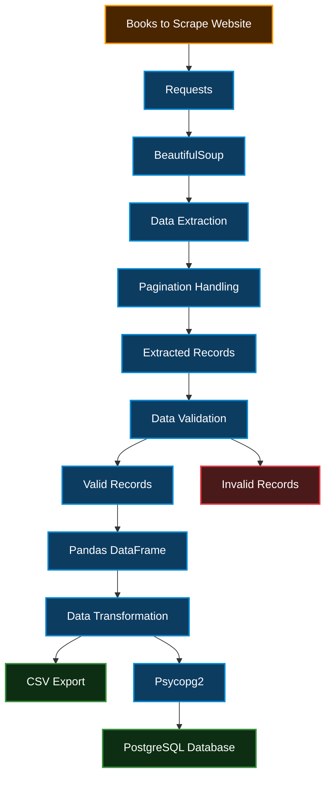
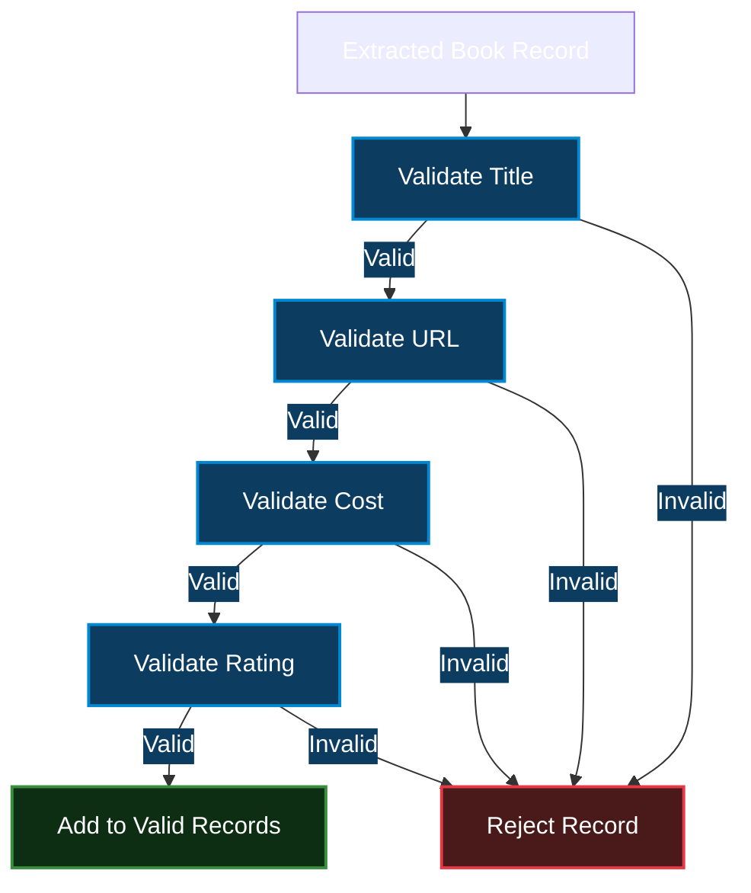
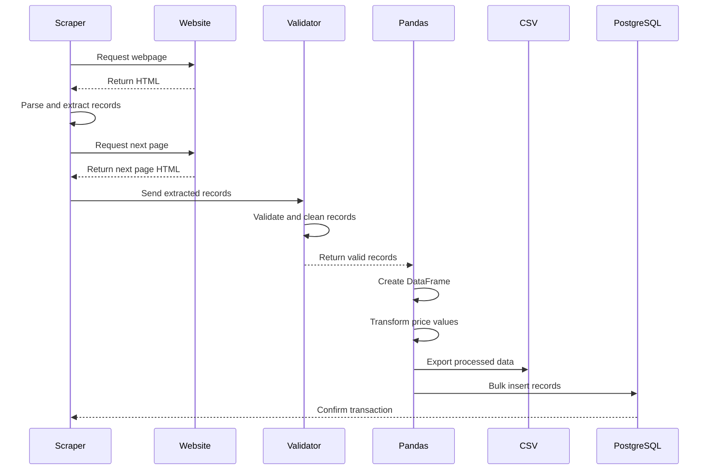

# Books to PostgreSQL | Web Scraping ETL Pipeline

<div align="center">
  
  
  
  
  
</div>

A Python-based ETL pipeline that extracts book data from [Books to Scrape](https://books.toscrape.com/), validates and transforms the extracted records using Pandas, exports the processed data to CSV, and loads it into a PostgreSQL database.

The project demonstrates a practical data engineering workflow involving web scraping, pagination, data validation, data transformation, database integration, and duplicate prevention.

---

## 📖 Project Overview

This project automates the extraction of book information from a paginated website and stores the processed records in PostgreSQL.

The pipeline follows three main ETL stages:

- **Extract:** Retrieve book information from multiple web pages using Requests and BeautifulSoup.
- **Transform:** Validate extracted records and convert price values into a numeric format using Python and Pandas.
- **Load:** Export processed data to CSV and insert records into PostgreSQL using Psycopg2.

---

## 🏗️ Architecture



---

## 🌟 Key Features

### 1. Automated Web Scraping
- Extracts book titles, prices, ratings, and product URLs.
- Uses `Requests` to retrieve webpage content.
- Uses `BeautifulSoup` to parse HTML and extract structured information.
- Handles HTTP errors and request timeouts.

### 2. Configurable Pagination
- Supports scraping a specified number of pages.
- Can scrape all available pages automatically.
- Uses the website's next-page link to navigate through pagination.

**Configuration in `configurable_pagination.py`:**
```python
pages_to_scrape = 5
```

To scrape all available pages:
```python
pages_to_scrape = None
```

### 3. Data Validation

A dedicated `validate_book()` function checks the quality of each extracted record.

| Field | Validation Rule |
| :--- | :--- |
| **Title** | Must not be missing or empty |
| **Cost** | Must be numeric, finite, and greater than zero |
| **Rating** | Must be One, Two, Three, Four, or Five |
| **URL** | Must not be missing or empty |

Invalid records are separated from valid records before further processing.

#### Data Validation Flow



### 4. Data Transformation with Pandas
- Converts extracted records into a Pandas DataFrame.
- Converts book prices from currency strings (e.g., `£51.77`) into numeric values.
- Prepares structured records for CSV export and database insertion.

### 5. CSV Export
- Exports validated data into a CSV file.
- Generates a unique timestamp-based filename for each execution.
- Excludes the DataFrame index from the exported file.

### 6. PostgreSQL Integration
- Connects to PostgreSQL using `Psycopg2`.
- Uses environment variables to manage database credentials.
- Performs bulk insertion using `executemany()`.
- Uses transaction management with `commit()` and `rollback()`.

### 7. Duplicate Prevention
- Uses a `UNIQUE` constraint on the product URL.
- Implements `ON CONFLICT (url) DO NOTHING`.
- Prevents duplicate product records from being inserted during repeated executions.

### 8. Error Handling and Resource Management
- Handles HTTP request exceptions.
- Handles PostgreSQL database errors.
- Uses rollback when a database operation fails.
- Closes database cursor and connection using a `finally` block.

---

## 🛠️ Technology Stack

| Technology | Purpose |
| :--- | :--- |
| **Python** | Core programming language |
| **Requests** | HTTP requests and webpage retrieval |
| **BeautifulSoup** | HTML parsing and data extraction |
| **Pandas** | Data transformation and tabular processing |
| **PostgreSQL** | Relational database storage |
| **Psycopg2** | Python to PostgreSQL connectivity |
| **python-dotenv** | Environment variable management |
| **SQL** | Database schema and data insertion |

---

## 📂 Project Structure

```text
books-to-postgresql-etl/
│
├── configurable_pagination.py         # Main ETL script (Extract, Transform, Load)
├── README.md                          # Project documentation
├── .gitignore                         # Excludes .env and generated CSVs
├── .env                               # Local database credentials (gitignored)
└── Books_*.csv                        # Generated CSV exports (timestamped)
```

**Note:** `.env` contains database credentials and must not be committed to GitHub. Generated CSV files can also be excluded from version control if they are only execution outputs.

---

## 🗄️ Database Schema

The pipeline stores the processed records in a PostgreSQL table named `books`.

```sql
CREATE TABLE books (
    id SERIAL PRIMARY KEY,
    title TEXT,
    cost NUMERIC(10,2),
    rating VARCHAR(20),
    url TEXT UNIQUE
);
```

### Schema Overview

| Column | Data Type | Description |
| :--- | :--- | :--- |
| **id** | SERIAL | Primary key |
| **title** | TEXT | Book title |
| **cost** | NUMERIC(10,2) | Book price |
| **rating** | VARCHAR(20) | Star rating |
| **url** | TEXT | Unique product URL |

---

## 🚀 Installation and Setup

### 1. Clone the Repository

```bash
git clone https://github.com/arsalankazi/books-to-postgresql-etl.git
cd books-to-postgresql-etl
```

### 2. Create a Virtual Environment

```bash
python -m venv venv
```

Activate it on Windows:
```bash
venv\Scripts\activate
```
Activate it on Linux/Mac:
```bash
source venv/bin/activate
```

### 3. Install Dependencies

```bash
pip install requests beautifulsoup4 pandas psycopg2-binary python-dotenv
```

### 4. Configure Environment Variables

Create a `.env` file in the project root:

```env
DB_HOST=localhost
DB_NAME=books_database
DB_USER=your_postgresql_username
DB_PASSWORD=your_postgresql_password
DB_PORT=5432
```

Replace the example values with your local PostgreSQL configuration.

### 5. Create the Database and Table

Create a PostgreSQL database named `books_database`, then execute the database schema SQL provided above. 

If the `books` table and its unique URL constraint already exist, do not create them again.

### 6. Run the Pipeline

```bash
python configurable_pagination.py
```

---

## 🔄 Expected Workflow



---

## 🔍 Data Verification

After execution, verify the number of records stored in PostgreSQL:

```sql
SELECT COUNT(*) FROM books;
```

View sample records:

```sql
SELECT * FROM books
LIMIT 10;
```

Check for duplicate product URLs:

```sql
SELECT url, COUNT(*)
FROM books
GROUP BY url
HAVING COUNT(*) > 1;
```

The duplicate check should return no rows.

---

## 🎓 Learning Outcomes

This project provides practical experience with:

- Building an end-to-end ETL pipeline.
- Extracting structured data from paginated websites.
- Working with HTTP requests and HTML parsing.
- Implementing configurable pagination.
- Applying record-level data validation.
- Transforming data using Pandas.
- Exporting processed datasets to CSV.
- Connecting Python applications with PostgreSQL.
- Performing bulk database insertion.
- Managing transactions and preventing duplicate records.
- Handling exceptions and database resource cleanup.

---

## 🔮 Future Improvements

Potential extensions for future versions:

- **Logging & Monitoring:** Integrate structured logging to monitor pipeline execution and failures.
- **Retry Mechanisms:** Add exponential backoff for failed HTTP requests.
- **Orchestration:** Migrate the batch script to Apache Airflow for automated scheduling.
- **Data Profiling:** Add basic data quality metrics before inserting into PostgreSQL.

---

## 👨‍💻 Author & Maintainer

<p align="left">
  
</p>

### **Kazi Arsalan Ajaj Ahmed**
*Data Engineer | Web Scraping & ETL*

[](https://github.com/arsalankazi)
[](https://linkedin.com/in/arsalankazi)
[](mailto:kaziarsalan810@gmail.com)

---

### 🎯 Core Engineering Focus

- **Web Scraping:** HTML Parsing, Pagination Handling, HTTP Request Management & BeautifulSoup.
- **Data Engineering:** End-to-End ETL Pipelines, Record Validation & Pandas Transformations.
- **Database Integration:** PostgreSQL, Bulk Inserts, Transaction Management & Upsert Logic.